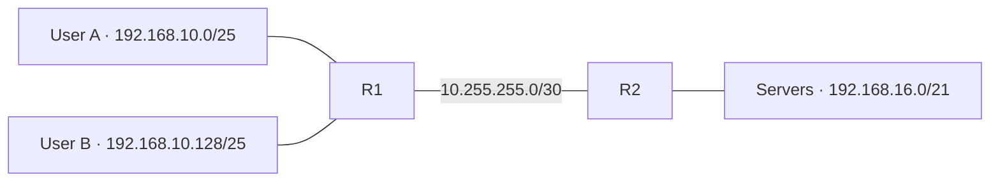

# Packet Tracer Routing and ACL Lab

A reproducible version of an Uccle networking exercise. It connects two user subnets and a server LAN with static routes. An extended ACL limits traffic from User A to the server LAN to HTTP, HTTPS and ICMP.



Use two routers and place a switch on each LAN. The interface names depend on the router model. Add a Server-PT host with HTTP enabled.

| Segment | Router interface | Example endpoint | Endpoint gateway |
| --- | --- | --- | --- |
| User A | `192.168.10.1/25` on R1 | `192.168.10.10/25` | `192.168.10.1` |
| User B | `192.168.10.129/25` on R1 | `192.168.10.130/25` | `192.168.10.129` |
| Transit | `10.255.255.1/30` on R1 and `10.255.255.2/30` on R2 | | |
| Servers | `192.168.16.1/21` on R2 | `192.168.16.10/21` | `192.168.16.1` |

## Configure routing and filtering

Assign the addresses and enable each interface. On R1, route the server LAN through R2.

```text
ip route 192.168.16.0 255.255.248.0 10.255.255.2
```

On R2, route the two contiguous user LANs through R1.

```text
ip route 192.168.10.0 255.255.255.0 10.255.255.1
```

On R1, create the following ACL. Apply `ip access-group SERVER_ACCESS in` on the interface facing User A.

```text
ip access-list extended SERVER_ACCESS
 permit tcp 192.168.10.0 0.0.0.127 192.168.16.0 0.0.7.255 eq 80
 permit tcp 192.168.10.0 0.0.0.127 192.168.16.0 0.0.7.255 eq 443
 permit icmp 192.168.10.0 0.0.0.127 192.168.16.0 0.0.7.255
 deny ip 192.168.10.0 0.0.0.127 192.168.16.0 0.0.7.255
 permit ip any any
```

## Verify in the simulator

- From User A, ping the server and open `http://192.168.16.10`.
- Enable FTP on the server to test the policy. A connection from User A should fail, and the deny rule should gain a match in `show access-lists`.
- Run `show ip route` on both routers to verify the forward and return paths.
